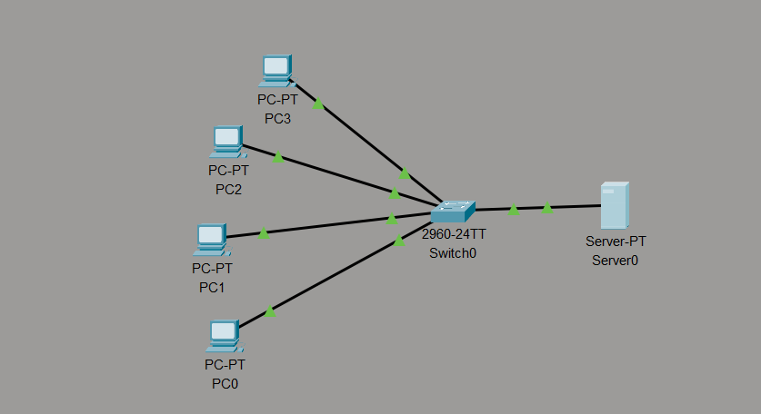
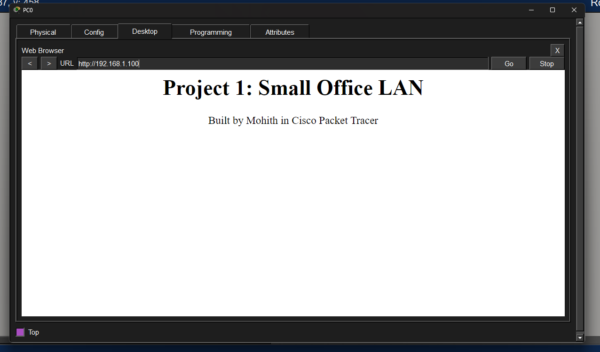

# Project 1: Small Office LAN

A small office network built in Cisco Packet Tracer, with one switch, four PCs, and a web server.

## Topology

## Devices and IP Addressing
| Device  | IP Address    | Subnet Mask   |
|---------|---------------|---------------|
| PC0     | 192.168.1.10  | 255.255.255.0 |
| PC1     | 192.168.1.11  | 255.255.255.0 |
| PC2     | 192.168.1.12  | 255.255.255.0 |
| PC3     | 192.168.1.13  | 255.255.255.0 |
| Server0 | 192.168.1.100 | 255.255.255.0 |

## What I Configured
- Connected all devices to a 2960 switch with copper straight-through cables
- Assigned static IP addresses in the 192.168.1.0/24 network
- Enabled the HTTP service on the server with a custom web page

## Testing
- PC0 successfully pinged all other PCs and the server with 0% packet loss 
- The web page on the server loaded from a PC browser at http://192.168.1.100 

## Tools
Cisco Packet Tracer 

## What I Learned
- How to assign static IP addresses to PCs and a server so they can communicate on the same network (192.168.1.0/24)
- How a switch connects devices within one network without needing a router or gateway
- How to use `ping` to verify connectivity between devices
- How to enable the HTTP service on a server and access it from a PC's web browser
- What a device configuration file (`show running-config`) is and why network engineers save it for backup, documentation, and troubleshooting